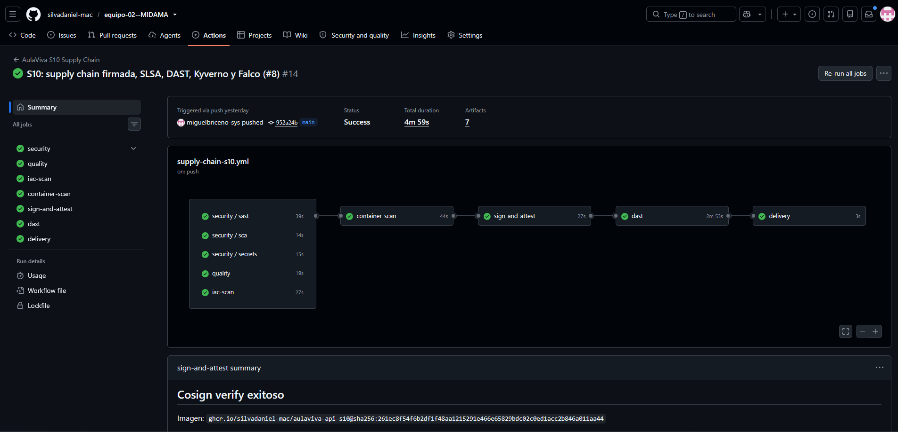
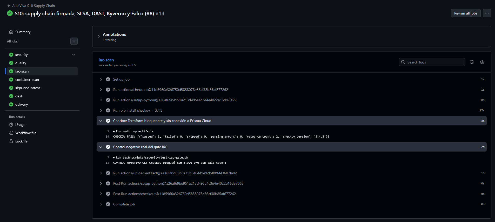
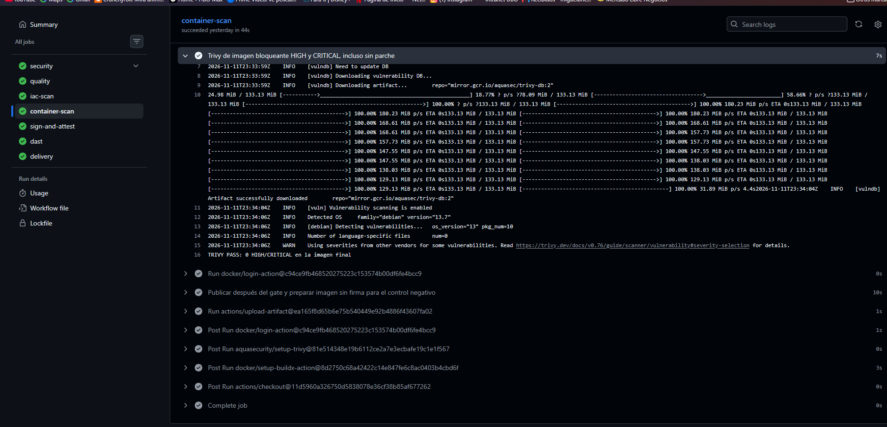
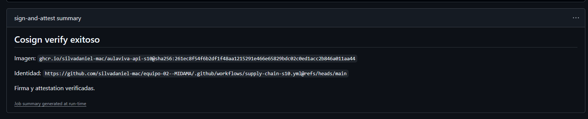
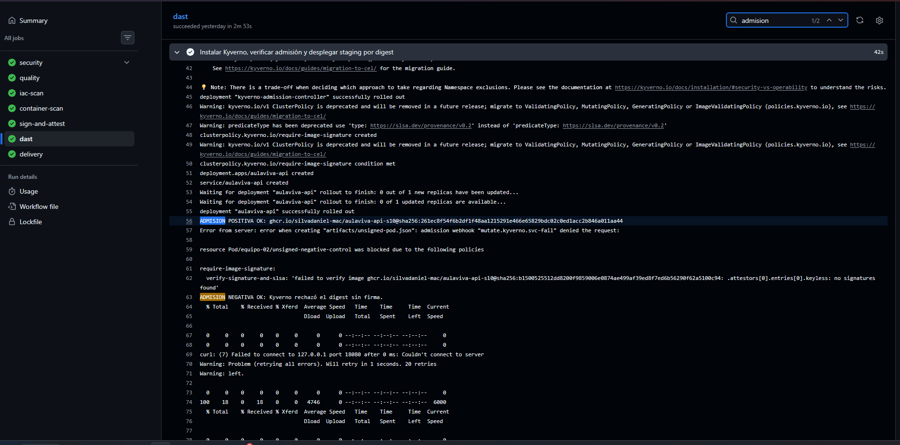
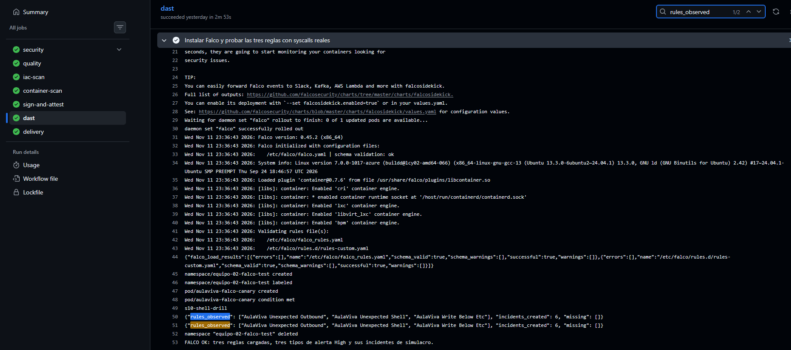
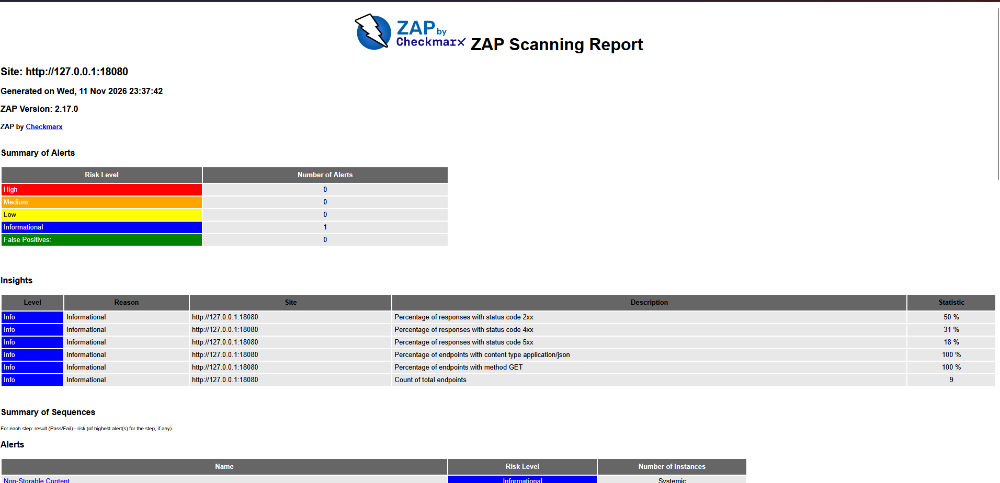

# Capturas originales de S10

Siete capturas tomadas y proporcionadas por Miguel Briceño para la presentación de AulaViva MIDAMA. Todas corresponden al [run 43120652802, ejecución #14 en main](https://github.com/silvadaniel-mac/equipo-02--MIDAMA/actions/runs/43120652802), commit `952a24b241fa969e260d72c4522e5b3aaf2e85be`.

[Presentación S10 corregida](../../../presentaciones/AulaViva_MIDAMA_Sesion10_DevSecOps_II_Final.pptx). Los PNG conservan sus bytes originales. La PPT usa recortes proporcionales para destacar resultados. `manifest.json` registra los SHA-256.

| Captura | Evidencia | Resultado observado |
| --- | --- | --- |
| [01-pipeline-main.png](01-pipeline-main.png) | Pipeline | Jobs aprobados en main |
| [02-checkov.png](02-checkov.png) | IaC y control negativo | 1 control aprobado, SSH público rechazado |
| [03-trivy.png](03-trivy.png) | Imagen final | 0 HIGH y 0 CRITICAL |
| [04-cosign-slsa.png](04-cosign-slsa.png) | Firma y attestation | Verificadas con identidad del workflow en main |
| [05-kyverno.png](05-kyverno.png) | Admisión | Imagen firmada admitida y digest sin firma rechazado |
| [06-falco.png](06-falco.png) | Simulacro aislado | 3 reglas propias observadas, 6 incidentes, ninguna faltante |
| [07-zap.png](07-zap.png) | Informe visual ZAP | 0 High, Medium y Low, 1 tipo de alerta informativa |

## Interpretación y alcance

Los rechazos de Checkov y Kyverno son controles negativos intencionales. La configuración SSH insegura nunca recibe terraform apply.

Los seis incidentes Falco pertenecen al simulacro, identificado como drill. Se observaron las tres reglas propias y una regla incorporada también generó eventos. Seis incidentes no equivalen a seis reglas propias.

ZAP conserva Non-Storable Content, alerta informativa relacionada con Cache-Control: no-store. El gate bloquea Medium y High. El análisis mide la superficie HTTP disponible. Las rutas de negocio pendientes responden 501 y no se acredita la seguridad de funciones aún sin implementar.

Las capturas documentan esta ejecución concreta. Los commits posteriores y sus reportes se consultan por separado en Actions.

## Evidencias completas

### Pipeline

### Checkov

### Trivy

### Cosign y SLSA

### Kyverno

### Falco

### ZAP

