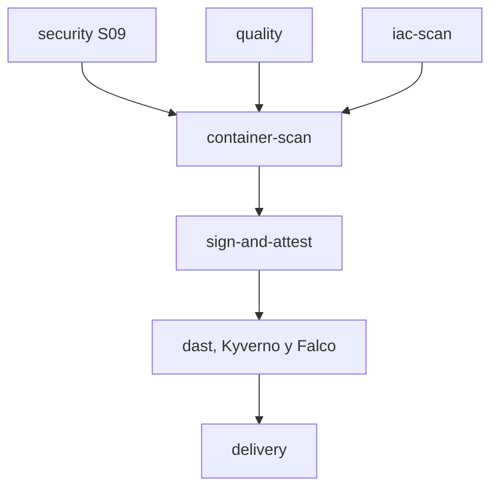

# Sesión 10: DevSecOps II y supply chain

La entrega extiende S09 con seguridad de la cadena de suministro y pruebas en un staging real efímero. La consigna corresponde a la diapositiva 7 de la presentación del profesor.

## Ejecución

El workflow **AulaViva S10 Supply Chain** se ejecuta en pushes a `main` y `feature/s10-supply-chain`, o manualmente. Los checks de push sobre la rama se vinculan al PR por SHA. La rama no usa `pull_request_target` ni ejecuta código de forks con permisos de firma.

`dast` instala Kyverno y Falco, prueba admisión, despliega el staging y ejecuta ZAP. Cualquier fallo impide que `delivery` se complete. Las ramas del job `security` conservan SAST, SCA y secrets en paralelo.

## Matriz de la rúbrica

| Criterio de diapositiva 7 | Puntos | Implementación | Evidencia del run |
| --- | ---: | --- | --- |
| DAST integrado | 15 | `dast`, ZAP baseline por port-forward | `s10-dast-runtime-<SHA>/zap/` |
| IaC y container scan bloqueantes | 20 | `iac-scan` con Checkov y `container-scan` con Trivy | `checkov.json`, control negativo y `trivy-image.json` |
| Firma Cosign y verify | 20 | `sign-and-attest`, OIDC con identidad exacta | `cosign-verify.json`, controles de firma |
| Attestation SLSA nivel 2 | 20 | Build hospedado, predicate v0.2 adjunto y firmado | `provenance.json`, `verified-statement.json`, `slsa-verification.txt` |
| Policy y tres reglas Falco | 20 | `k8s/policies/require-signature.yaml`, `falco/rules-custom.yaml` | Admisión positiva/negativa, alertas y registros de incidente |
| Puntualidad | 5 | Entregar antes del inicio de S11 | La fecha exacta de la clase debe confirmarla el equipo |

Esta tabla relaciona requisitos con pruebas, no asigna una nota ni certifica una evaluación del profesor.

## Archivos de entrega exigidos

- Pipeline: `.github/workflows/supply-chain-s10.yml` con `iac-scan`, `container-scan`, `sign-and-attest` y `dast`.
- Verificación: `cosign verify` se ejecuta de forma bloqueante en el pipeline.
- Policy: `k8s/policies/require-signature.yaml`, nombre `require-image-signature`.
- Falco: `falco/rules-custom.yaml`, exactamente tres reglas propias y sus macros.
- Decisión: [ADR 0006](../adr/0006-supply-chain.md).
- Pruebas y capturas: [índice de evidencias](../evidencias/s10/README.md).

## Cómo reproducir y comprobar

1. Consultar el run del SHA entregado en [Actions](https://github.com/silvadaniel-mac/equipo-02--MIDAMA/actions/workflows/supply-chain-s10.yml).
2. Confirmar que los jobs S09, calidad y S10 terminaron correctamente.
3. Descargar los cuatro artefactos `s10-iac-*`, `s10-container-*`, `s10-signature-slsa-*` y `s10-dast-runtime-*`.
4. Revisar que la firma tiene el issuer `https://token.actions.githubusercontent.com` y el subject exacto del workflow y ref del run. El mismo digest debe aparecer en firma, attestation y staging.
5. Abrir `admission-negative.txt`. Debe ser un rechazo de `verify-signature-and-slsa` y el Pod sin firma debe estar ausente.
6. Revisar `falco-summary.json`, las tres reglas observadas y los registros de `incidents/`. Cada registro conserva el evento original y el responsable.
7. Abrir el reporte HTML de ZAP y comprobar el gate Medium+. Las alertas Low/Info se conservan y se explican en el índice de evidencia.

## Alertamiento Falco

| Regla | Justificación en AulaViva | Ruta de alerta |
| --- | --- | --- |
| AulaViva Unexpected Shell | El backend distroless no usa shells | Evento JSON, registro High, responsable de seguridad del equipo |
| AulaViva Write Below Etc | La configuración del contenedor debe permanecer inmutable | Evento JSON, registro High, revisar cambios y contener el Pod |
| AulaViva Unexpected Outbound | La base actual no necesita conexiones externas distintas de DNS | Evento JSON, registro High, investigar destino y posible exfiltración |

El pipeline guarda un incidente por alerta High, incluido el simulacro. La sonda usa su propio namespace y no desactiva la policy de staging. En una instalación permanente deberá conectarse la misma salida JSON a un receptor de incidentes supervisado. Este laboratorio no configura Slack ni finge una guardia de producción activa.

## Preparación S11

Se incorpora el [runbook inicial de disponibilidad](../runbooks/aulaviva-availability.md), basado en salud del servicio, rollout y evidencia del release por digest. Sirve para comenzar la próxima sesión de observabilidad y SLOs. No se afirman métricas históricas ni un error budget medido que todavía no existen.

## Acciones del dueño, al final

Con acceso de escritura se entrega el código, el PR, el pipeline y las pruebas. El administrador debe activar protección de `main`, revisión y checks obligatorios. La evidencia de esta entrega identifica el nombre exacto de los checks disponibles. No es necesario configurar credenciales AWS, pagar un clúster ni hacer público GHCR para completar el laboratorio.
