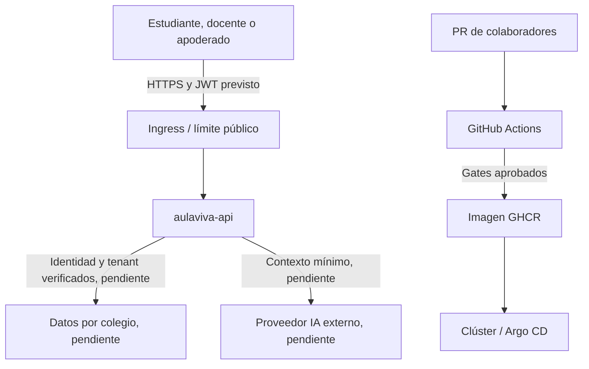

# Modelo de amenazas STRIDE: aulaviva-api

Fecha: 5 de noviembre de 2026. Equipo MIDAMA. Revisión: cada release mayor y ante cambios de identidad, datos o integración IA.

## Alcance y estado real

El componente analizado es `services/api/server.mjs`, base Node.js del backend AulaViva. Hoy implementa `/`, `/healthz`, `/readyz` y carga opcional de laboratorio. Las rutas `/api/` responden **501**. No existe todavía autenticación JWT, persistencia académica ni integración con un proveedor LLM. OpenAPI describe el diseño futuro. Los controles pendientes de esta tabla son condiciones para habilitar esos endpoints, no capacidades ya desplegadas.

## Activos y actores

Los activos previstos son datos de menores, calificaciones, contenidos, membresías por colegio, credenciales y tokens del proveedor IA. Los activos actuales incluyen código, historial Git, imagen GHCR, workflows y manifiestos GitOps. Los actores son estudiantes, docentes, apoderados, administradores por colegio, mantenedores y servicios externos. Un atacante puede ser anónimo, un usuario de otro colegio o alguien que comprometa una dependencia o credencial.

## Flujos y límites de confianza

El navegador y sus parámetros no son confiables. La API debe derivar el tenant de la identidad y verificarlo contra `schoolId`. Base de datos y proveedor IA son límites independientes. El PR contiene código no confiable: los jobs de seguridad reciben solo lectura y no usan secretos persistentes. El entorno kind de S08 es temporal y no representa producción.

## STRIDE y mitigaciones

| ID y categoría | Amenaza concreta y activo | Riesgo y explotabilidad | Mitigación y estado | Verificación y responsable |
| --- | --- | --- | --- | --- |
| S1 · Spoofing | Cliente falsifica JWT o schoolId para acceder como docente de otro colegio | Alto al habilitar negocio, datos de menores | **Pendiente:** validar firma con lista de algoritmos, issuer, audience y expiración. Derivar tenant de membresía autenticada, nunca confiar solo en URL | Backend: pruebas 401 por JWT inválido y 403/404 entre colegios antes de activar endpoints |
| T1 · Tampering | Cambiar nota o payload entre cliente y servicio | Alto al implementar escritura | **Pendiente:** TLS en Ingress, validación de esquema y autorización por recurso. Idempotencia en escrituras según OpenAPI. **Actual:** regla Semgrep bloquea TLS desactivado | Backend/Plataforma: prueba de rechazo de nota fuera de esquema y actualización sin permisos |
| R1 · Repudiation | Docente niega haber modificado una calificación | Alto para integridad académica | **Pendiente:** audit log con actor, tenant, recurso, timestamp y trace_id. Almacén con escritura restringida y política de retención. **Actual:** Git registra cambios técnicos, no eventos académicos | Backend: comprobar correlación de cambio y auditoría, acceso a logs restringido |
| I1 · Information disclosure | API o logs revelan notas, tokens o datos de otro colegio | Alto cuando haya datos reales | **Actual:** respuestas base sin datos personales y Cache-Control no-store. Gitleaks sobre historial. **Pendiente:** filtros tenant en cada consulta, redacción de logs, gestor de secretos y contexto mínimo al LLM | Backend/Seguridad: prueba multitenant, buscar datos sensibles en logs y revisar permiso del proveedor IA |
| D1 · Denial of service | Saturación HTTP o activar carga CPU de laboratorio | Medio hoy, alto ante exposición pública | **Actual:** timeouts HTTP de 5 s, trabajo lab acotado y desactivado por defecto, límites y HPA de S07. **Pendiente:** rate limit por identidad/tenant, límites de body, cuotas LLM y presupuesto de consumo | Plataforma: prueba de carga, 429 por exceso, confirmar ENABLE_LAB_LOAD ausente en producción |
| E1 · Elevation of privilege | Estudiante usa operación de docente o contenedor obtiene privilegios | Alto al habilitar negocio | **Actual:** imagen no root, read-only/cap-drop en smoke y securityContext Kubernetes. **Pendiente:** RBAC de negocio y autorización por objeto, no solo ocultar botones | Backend/Plataforma: prueba 403 para alumno al crear nota y verificar UID/capacidades |
| T2 · Supply chain | PR o dependencia introduce ejecución de código o imagen alterada | Alto hoy en CI | **Actual en S09 local:** SAST OWASP y reglas propias, Trivy, SBOM, Gitleaks. CI preparado para bloquear build con los tres jobs. S08 firma GHCR. **Pendiente remoto:** ejecutar PR y activar protección de main | Mantenedor: revisar checks, artefactos, digest y firma antes de merge |
| I2 · Secretos | Token LLM borrado del archivo sigue accesible en Git | Alto si aparece credencial real | **Actual:** Gitleaks con historial completo sin baseline de exclusión. **Pendiente operativo:** revocar primero, rotar mediante gestor, TTL menor de 90 días y acceso por tenant | Seguridad: registrar revocación sin copiar el valor y reescanear historial |

## Priorización y aceptación

Primero se atienden secretos reales y fallos alcanzables desde Internet. Critical: menos de 7 días; High: menos de 30; Medium: menos de 90. Un CVSS alto no demuestra por sí solo que el runtime sea vulnerable, pero una dependencia de desarrollo sigue pudiendo afectar CI. No habilitar operaciones académicas hasta completar identidad, aislamiento por tenant y autorización. Las excepciones requieren evidencia de no alcanzabilidad, responsable, aprobación independiente y fecha de expiración según el README.

## Riesgo residual

El servidor actual sirve para comprobar infraestructura. Los escáneres no demuestran aislamiento multitenant ni ausencia de vulnerabilidades. El modelo se debe revisar con código de negocio real y pruebas de autorización antes de usar datos de estudiantes. La protección de rama está desactivada en la lectura remota de esta revisión y requiere actuación de un administrador.
